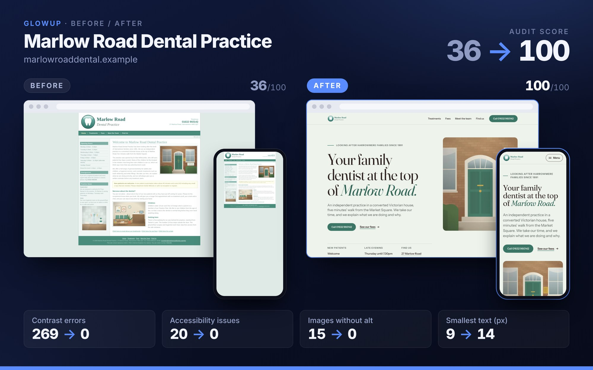
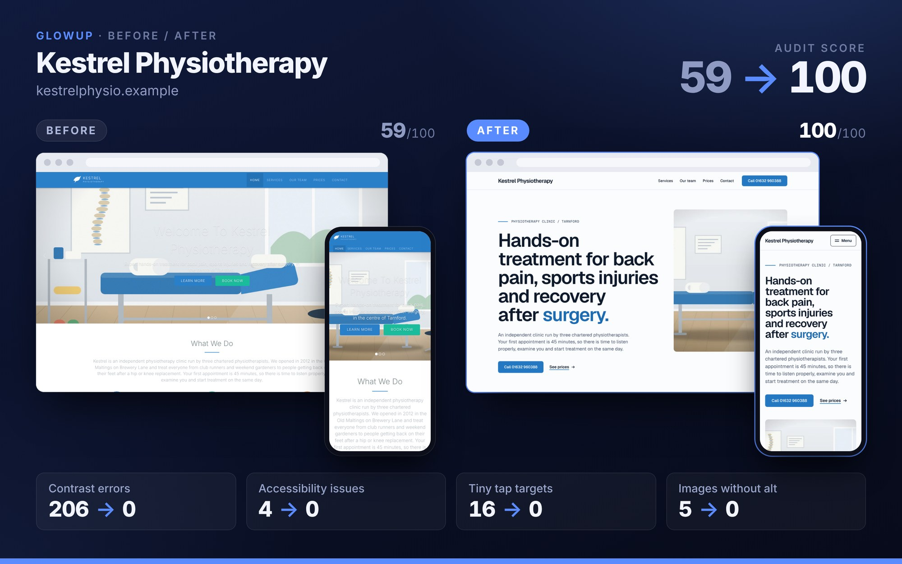
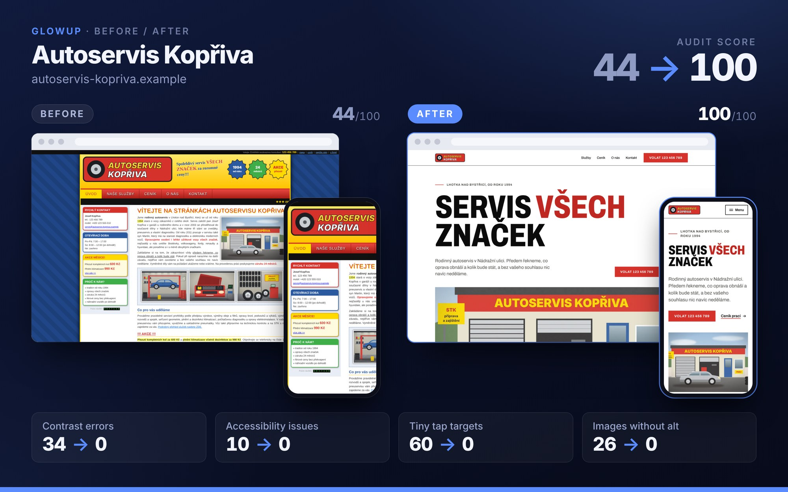
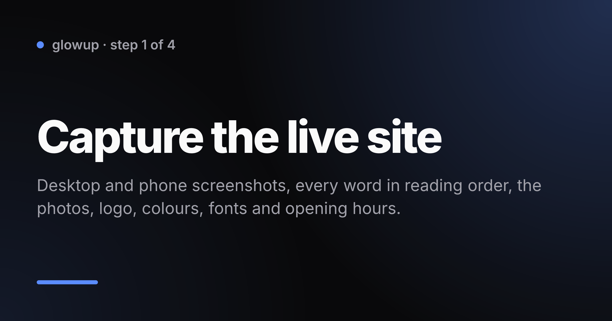
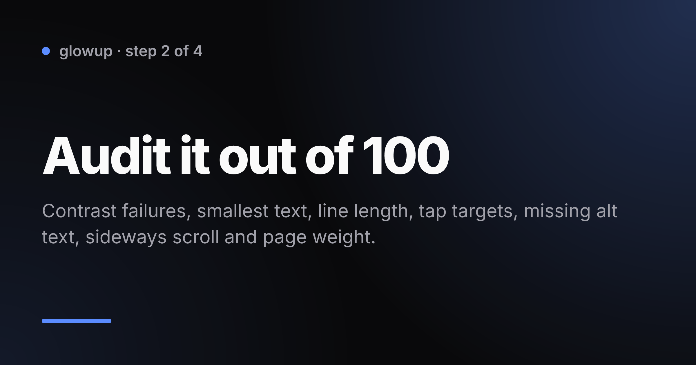
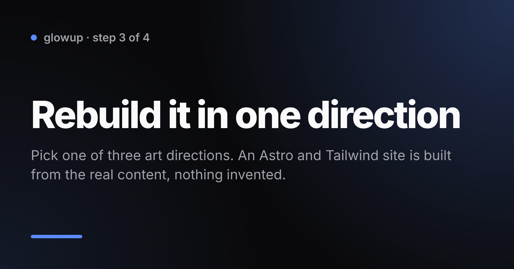
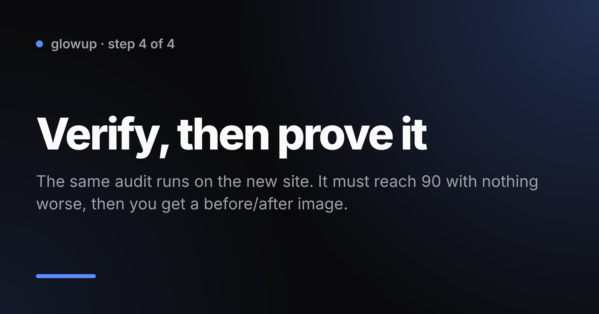

<h1 align="center">glowup</h1>

<p align="center">
  <strong>Give it a URL. Get back a redesign, with proof.</strong><br>
  An agent skill for Claude Code and Codex that rebuilds old websites and shows the numbers.
</p>

<p align="center">
  <a href="https://github.com/whosdrix/glowup/actions/workflows/ci.yml"></a>
  <a href="https://github.com/whosdrix/glowup/releases"></a>
  <a href="LICENSE"></a>
</p>

<p align="center">
  
</p>

## Install

In Claude Code:

```
/plugin marketplace add whosdrix/glowup
/plugin install glowup@glowup
```

Then:

```
/glowup https://your-old-site.com
```

For Codex or any other agent that reads `SKILL.md` files, copy `skills/glowup` into its skills folder (for Codex, `~/.codex/skills/glowup`). You need Node 22 or newer. On first run the scripts fetch a headless browser, or use the Chrome you already have.

## What you get

```
glowup/your-old-site.com/
├─ capture/        screenshots, every page's text, brand colours, fonts, logo, photos
├─ audit.md        the old site's score out of 100 and what is wrong with it
├─ direction.md    the art direction you picked
├─ site/           the new site: Astro + Tailwind, ready to deploy anywhere static
└─ proof/          before-after.png and the audit delta
```

The new site uses the real content of the old one: the same services, opening hours, phone numbers, photos and wording, cleaned up. Nothing is invented.

## Gallery

<p align="center">
  
  
</p>

These three are demo sites written for this repo (the businesses are made up), each in the style of a real era of small-business web design. The "after" sites were built by running the skill on them, start to finish. Their sources are in [`gallery/sites`](gallery/sites).

## How it works

<p align="center">
  
  
  
  
</p>

1. **Capture.** A headless browser visits the home page and up to four linked pages at desktop and phone sizes. It saves screenshots, all text in reading order, the photos, the logo, the colours weighted by how much of the page they cover, the fonts, and contact details including opening hours and schema.org data.
2. **Audit.** The same browser measures what is wrong: contrast failures (axe-core), the smallest text on a phone, characters per line, tap targets under 24px, images without alt text, sideways scrolling, layout shift and page weight. Every deduction from the score is listed with the element it came from.
3. **Directions.** The agent pitches three art directions from six recipes (editorial, bold minimal, warm local, crisp tech, quiet luxury, playful), each starting from the site's own brand colour. You pick one, or say "surprise me".
4. **Rebuild.** The agent fills a real Astro template with the captured content and restyles it through design tokens: colour roles, a type scale, spacing and a fixed reading width.
5. **Verify.** The new site is audited the same way. It has to score at least 90 and be no worse than the original on any check. Failures come back with page and selector, and the agent fixes them until it passes.
6. **Proof.** You get a before/after image like the ones above and a table of what changed.

The model does the taste. The scripts do the measuring, so two runs on the same site are judged by the same rules.

## What it won't do

The skill has a list of things that make a site look machine-made, and it is told to avoid all of them:

- purple-to-blue gradients, glass cards and blurred blobs as decoration
- emoji as bullet points, and a row of three identical icon cards as the only idea
- everything centred
- "Unlock your potential" and other copy that could be on any site
- stats, testimonials, awards or prices that were not on the original site
- lorem ipsum, stock photos and placeholder images

The full list is in [`references/anti-patterns.md`](skills/glowup/references/anti-patterns.md).

## Running the scripts yourself

The skill calls a small CLI, and you can too:

```sh
node skills/glowup/dist/glowup.mjs capture https://example.com
node skills/glowup/dist/glowup.mjs audit https://example.com
node skills/glowup/dist/glowup.mjs verify https://example.com   # after building site/
node skills/glowup/dist/glowup.mjs status https://example.com
```

`--pages <n>` sets how many pages to capture (default 5), `--root <dir>` moves the workspace, and `CHROMIUM_PATH` points it at a browser you already have.

## Not yet

- Next.js output
- Scroll videos of the new site
- Exporting content to a CMS
- Sites in more than one language

## Contributing

New art directions are the most welcome contribution. [CONTRIBUTING.md](CONTRIBUTING.md) explains the format and how to test one.

## License

[MIT](LICENSE)
